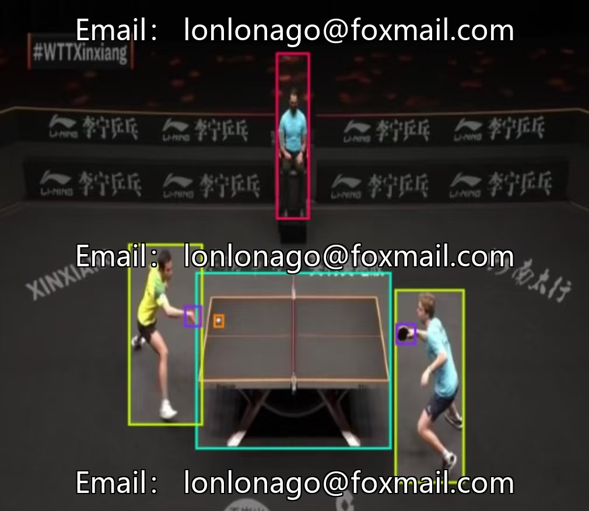
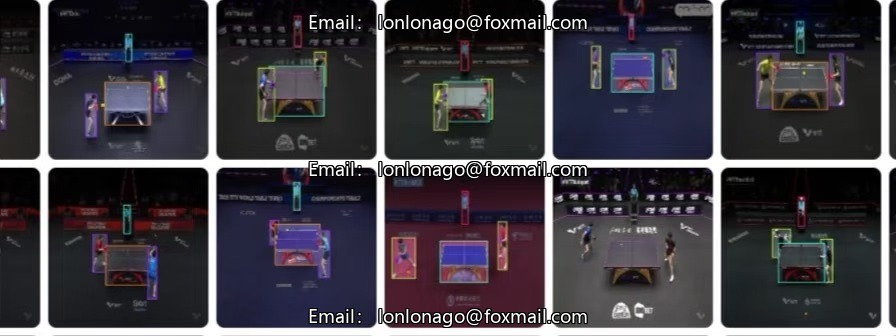
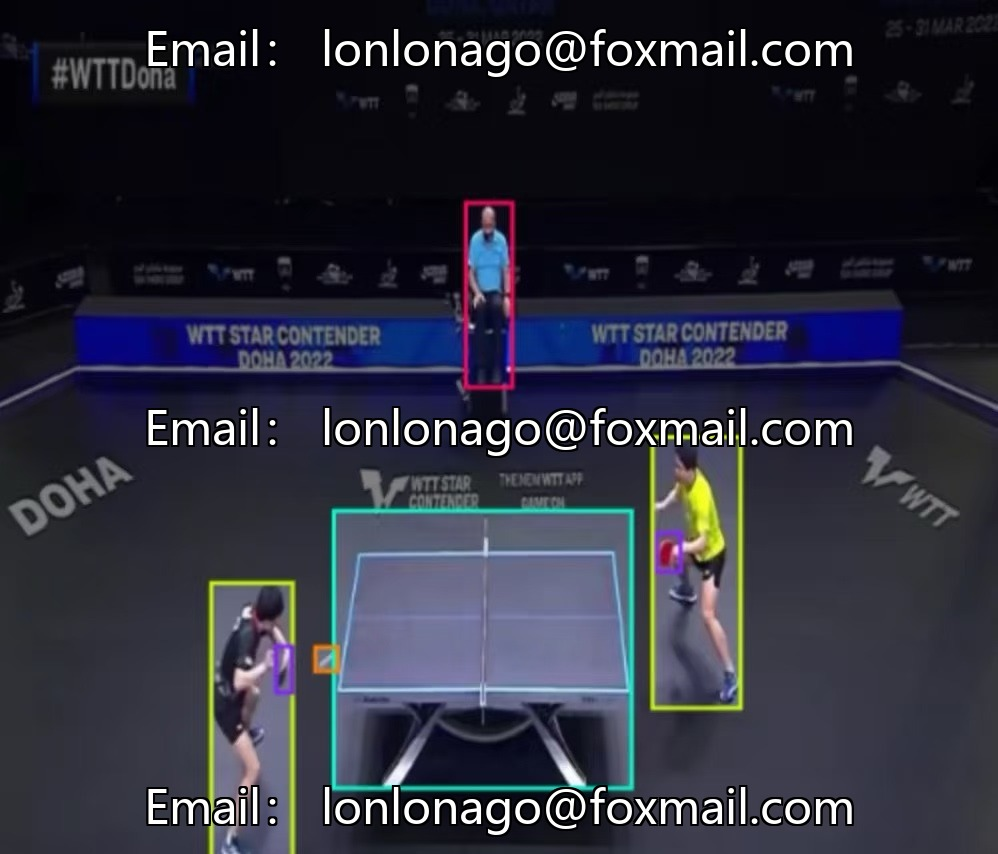
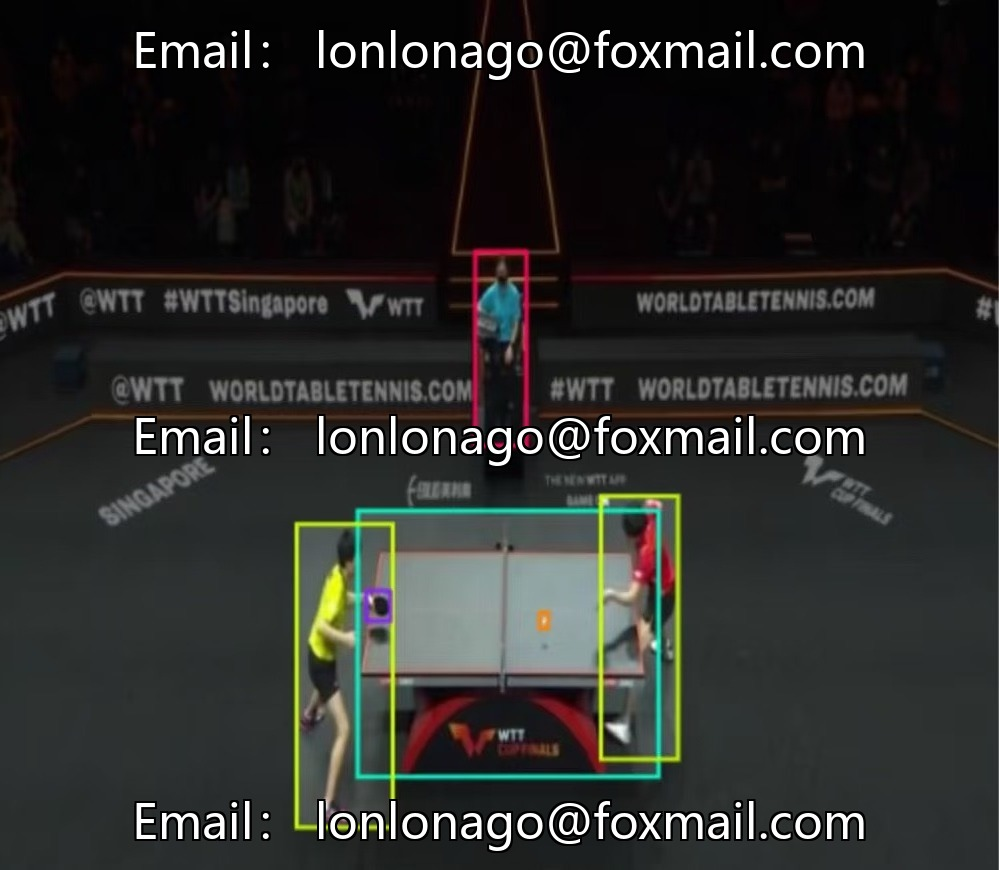

# Intelligent Sports Element Recognition - Table Tennis Identification Dataset, comprising 2229 image samples.

## Body

The dataset for intelligent sports element recognition of table tennis, including 2229 image samples and 5 sub-categories: racket, ball, athlete, referee, and paddle. It is suitable for computer vision object detection tasks. The dataset format is standardized, supports the training of mainstream models, has a supporting validation set, with sufficient quantity, clear structure, and facilitates model development and algorithm optimization.

Dataset core information: 5 categories, 2229 images, 44 dataset files, 131 validation set, adaptable for YOLO object detection model, supports academic research and technical development.

Virtual materials, once sold, are non-refundable.
Interested friends, click "I want" to proceed.

## Images

## Payment

Here is a pay link on Stripe ( https://buy.stripe.com/3cs8yP7sY87d0vu9AB ). Please contact me lonlonago@foxmail.com after funding $89, and I will send you a complete data files , thank you!

